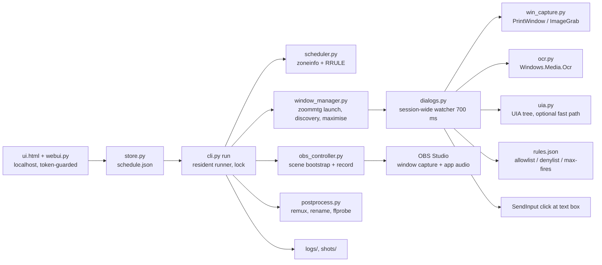

# Zoom Auto-Recorder — Phased Implementation Plan

Scheduled, unattended Zoom recording on one Windows machine: paste a link, pick date/time + repeat, and the tool
joins with the **native Zoom client**, clears consent/acknowledge dialogs by *reading* them, records with **OBS**,
and files an mp4 when the meeting ends.

Base: `digi-millz/zoom-auto-recorder` @ `59ed3f1` (cloned here). Python 3.13, Click, `obs-websocket-py==1.0`,
3 815 lines, 85 passing tests. We **extend** it; we do not rewrite it.

> **Status: delivered (2026-11-14).** P1–P5 are implemented and verified against live meetings; the measured
> evidence (dialog inventory, capture matrix, audio) is in `docs/spikes.md`, the working rules are in `AGENTS.md`.
> Read the plan for the reasoning; read `docs/spikes.md` for what the machine actually does. Open items: per-event
> mic, auto-leave, and `.ics` RRULE fidelity — see the Limitations in `README.md`.

---

## 1. Where we actually stand

| Fact | Evidence |
| --- | --- |
| Repo cloned, `main` @ `59ed3f1`, single commit, **no LICENSE** | `git log`; no `LICENSE*` → private use only |
| Python 3.13.2 real, at `E:\Programs\Python\Python313` | bare `python` is the Store stub → use `py` or `.venv` |
| Deps installed in `.venv`; **85/85 tests pass** | `.venv\Scripts\python -m unittest discover -s tests -t .` |
| Zoom desktop installed per-user | `%APPDATA%\Zoom\bin\Zoom.exe` |
| OBS **not installed** | no `%APPDATA%\obs-studio`, no Program Files entry |
| ffmpeg 9.0.2 on PATH; GTX 1060 (NVENC) + UHD 630 | `winget`-installed Gyan build; `nvidia-smi` |
| Display 96 DPI / 100 %; Win 11 26300 | click math is 1:1 today, code must not assume it |

### What the base already solves

`zoommtg://` launch with passcode · Win32 window discovery (**real observed Zoom classes**: `ZPMeetingMainWndClass`,
`ConfMultiTabContentWndClass` 7.x, `zWaitingRoomWndClass`, `zChangeNameWndClass`, `zRichMsgBoxClass` = disclosure,
`VideoPreviewWndClass` = prejoin) · maximise + foreground · OBS v5 `SetRecordDirectory`, **confirmed**
`StartRecord`/`StopRecord`, path from `RecordStateChanged` · OBS auto-launch fallback · JSON schedule with
recurrence roll-forward, runner lock, stop marker, crash recovery · disk preflight · exit codes 0–8 ·
token-guarded localhost GUI · `.ics` import · Task Scheduler install · `probe`.

### The one thing it does badly

`window_manager.py:404 accept_prompt()` presses **Enter** on any `zRichMsgBoxClass` and clicks a **fixed
relative point** (0.88, 0.92) on the prejoin window, for at most `--auto-accept-seconds` (20 s), with no
read-back and no screenshot. Zoom renders dialogs with CEF into a single HWND, so there are no child controls to
inspect — pixels or accessibility are the only options, and the base chose guessing.

Everything else is smaller: monitor-based capture with no scene setup, naive local time, `weekly|weekdays` only,
no remux/rename/duration check.

---

## 2. Decisions (unchanged, now applied to the Python base)

| Decision | Choice | Why |
| --- | --- | --- |
| Recording | OBS + obs-websocket v5 | the only option with **per-process** audio (`Application Audio Capture` on `zoom.exe`) + HW encode + crash-safe mkv + remote start/stop |
| Join | native client, `zoommtg://…&pwd=…` | deterministic; the web client depends on *host* settings we don't control |
| Dialog dismissal | UIA → **OCR** → template → nothing | must read the dialog; Enter/fraction-clicking is unfixable by tuning |
| Scheduling | `zoneinfo` + RRULE (`dateutil`) | "every 2 weeks" isn't cron; DST must not shift 10:00 local |
| Storage | keep `schedule.json`, extend entries | 85 tests already cover it; SQLite buys nothing here |
| Stack | Python 3.13, extend in place | 3 815 tested lines beat a greenfield rewrite |


### 2.1 Provenance — best of both, borrowed selectively

Nothing is rewritten wholesale. Each subsystem is either **kept** from the base, **replaced** by a designed
module, or **dropped** from the original greenfield plan as unnecessary for a single-user tool.

| Subsystem | Source | Note |
| --- | --- | --- |
| OBS websocket control (`obs_controller.py`) | **keep** | confirmed requests, `SetRecordDirectory` fallbacks, event path capture |
| Window discovery + Zoom class names (`window_manager.py`) | **keep** | empirical; `accept_prompt`/`_click_relative` deleted only |
| Store, runner, lock, stop marker, crash recovery | **keep** | JSON + lock is right-sized |
| GUI, `.ics` import, Task Scheduler, exit codes, `probe` | **keep** | additive fields only |
| Consent/prejoin dismissal | **merge** | keep its class targeting + prejoin knowledge, replace the *action*: OCR label → click → verify → alarm |
| Capture | **replace** | monitor scene → window capture + `Application Audio Capture` (`scene.py`) |
| Time/recurrence | **replace** | naive local → `zoneinfo` + RRULE (`scheduler.py`) |
| Post-run file handling | **add** | remux, rename, `ffprobe` (`postprocess.py`) |
| SQLite, one child process per run, SSE live panel | **drop** | my own gold-plating; a lock + `schedule.json` + 700 ms polling is enough here |

Non-negotiables while merging: one runtime, one process model (runner + watcher threads), one config format
(`schedule.json` + `rules.json`), and **additive-only CLI** — no existing flag changes meaning.

---

## 3. Target architecture



New modules: `dialogs.py`, `ocr.py`, `win_capture.py`, `uia.py`, `scene.py`, `postprocess.py`, `rules.json`,
`tests/test_dialogs.py`. Modified: `cli.py` (watcher replaces the 20 s thread), `window_manager.py` (drop the blind
click paths), `store.py` (entry fields), `scheduler.py` (zoneinfo + RRULE), `webui.py`/`ui.html` (new fields,
next-occurrence preview).

---

## 4. Config shapes

`schedule.json` entry as implemented (`store.Entry`; unknown keys are ignored on load, `repeat` kept as a legacy
alias for `rrule`):

```json
{
  "id": "4bfaf89e", "url": "https://us02web.zoom.us/j/81234567890?pwd=abc",
  "start": "2026-11-09 10:00", "tz": "Europe/London",
  "rrule": "FREQ=WEEKLY;INTERVAL=2;BYDAY=WE", "anchor": "2026-11-09 10:00",
  "repeat": null, "output_dir": null, "note": "standup", "email": null,
  "mic": false, "status": "pending", "created": "2026-11-01 09:00:00",
  "last_exit_code": null, "last_path": null
}
```

Settings live next to the entries (`settings.output_dir`, `settings.email`, `settings.notify_url`,
`settings.calendar_url`). Session options (`duration_min`, `prejoin_sec`, …) are CLI flags on `record`/`run`, not
per-entry keys — the entry owns only what differs between meetings.

`rules.json` — behaviour as data, so a Zoom rename doesn't need a code change:

```json
{ "version": 1,
  "deny": ["Cancel", "Decline", "Sign In", "Switch Account", "Leave", "End Meeting", "Remove"],
  "rules": [
    { "name": "consent", "scope": "dialog",
      "match": { "text": ["Acknowledge", "Continue", "Got it", "I Agree"] },
      "action": { "kind": "clickText" }, "max_fires": 3 },
    { "name": "join-audio", "scope": "any",
      "match": { "text": ["Join with Computer Audio", "Use Computer Audio"] },
      "action": { "kind": "clickText" }, "max_fires": 2 },
    { "name": "prejoin", "scope": "prejoin",
      "match": { "text": ["Join"], "exclude": ["Join with", "Join a Meeting"] },
      "action": { "kind": "clickText" }, "max_fires": 2 }
  ] }
```

Invariants the engine enforces: **denylist wins over allowlist**; a rule fires at most `max_fires` per run;
no match → no click + `needs_attention`; every attempt writes `shots/<runId>/<ts>_<window>_{before,after}.png` plus
an OCR word dump.

---

## 5. Phases

Order is deliberate: **measure before building** (P0), **build the testable core before touching a live meeting**
(P1–P2), **close the highest-risk live path next** (P3), then capture (P4), scheduling (P5), operations (P6).

### P0 — Measure reality · no product code

1. `winget install OBSProject.OBSStudio`; enable **Tools → WebSocket Server Settings**, set a password.
2. Build the scene by hand once: **Window Capture** (match by executable `zoom.exe`) + **Application Audio
   Capture** on `zoom.exe`. Dump the *real* source settings JSON (`GetInputSettings`) — that JSON is what P4
   replays, so nothing is guessed.
3. Join a throwaway meeting and capture, for each dialog that appears: window class, UIA tree, OCR words+boxes,
   and frames from both `PrintWindow(PW_RENDERFULLCONTENT)` and `ImageGrab`.
4. Verify NVENC is what OBS actually uses; record 60 s and confirm the file plays.

**Deliverable** `docs/spikes.md` + `fixtures/dialogs/*.png|json` (real disclosure, prejoin, in-meeting ack).
**Gate** — which layer fires on this Zoom build (UIA usable? OCR accurate? which capture method is non-black?).
If OCR on `zRichMsgBoxClass` is bad, the plan shifts to template-matching for that window; everything else stands.

### P1 — Harness, fixtures, inspect command

* `requirements.txt`: `pillow`, OCR binding (`winrt-runtime` + `winrt-Windows.Media.Ocr` +
  `winrt-Windows.Graphics.Imaging`; fall back to `winsdk`, then `pytesseract`), `python-dateutil`.
* `win_capture.py` — `grab(hwnd) -> Image`; DPI awareness (`SetProcessDpiAwarenessContext`, PerMonitorV2) set at
  process start; PrintWindow first, ImageGrab + foreground-raise fallback; `is_black()` check.
* `ocr.py` — `words(image) -> list[Word(text, box)]`.
* `uia.py` — `buttons(hwnd) -> list[(name, rect)]`; returns `[]` on failure, never raises.
* `cli.py`: `inspect` command → dumps windows, UIA tree, OCR words, capture frames to `shots/`.

**Accept** `.venv\Scripts\python main.py inspect --url <link> --seconds 20` writes a complete dump from a live
meeting; existing 85 tests still pass.

### P2 — Dialog matcher (pure, offline)

* `dialogs.py::pick(words, rules, fired_counts) -> Click|None` — **pure function**. Allowlist → deny → box centre.
  Scope filtering (`dialog` / `prejoin` / `any`). Case-insensitive, whitespace-normalised, optional fuzzy
  (difflib ratio ≥ 0.85) for OCR noise.
* `tests/test_dialogs.py` — driven by `fixtures/dialogs/*.json` word lists: picks "Acknowledge" over "Cancel";
  deny wins; unknown dialog → `None`; `max_fires` respected; click point = box centre; OCR typos
  ("Acknow1edge") still match.
* Replay harness: every fixture image → expected label. No Zoom, no OBS, deterministic.

**Accept** tests cover ≥ 3 real dialogs + 5 synthetic adversarials, all green; matcher has zero I/O.

### P3 — Live dialog handling (the actual fix)

* Delete `accept_prompt`'s Enter path and `_click_relative`'s fixed fractions. Keep `iter_windows`/class sets.
* `dialogs.py::watch(...)` — loop every 700 ms from launch until the meeting window dies:
  enumerate Zoom windows → for each prompt/prejoin/meeting window: UIA → OCR → template → click → **verify**
  (window gone or text changed) → retry other labels ≤ 3 → screenshot every attempt → on exhaustion emit
  `needs_attention` (exit code + GUI badge) instead of clicking blind.
* `cli.py`: start the watcher *before* `find_meeting_window`, run it for the whole session, stop it in `finally`.
* Click via `SendInput` with absolute normalised coords from physical pixels.

**Accept** live join: passcode + disclosure → log shows
`dialog zRichMsgBoxClass → "Continue" @ (x,y) → closed (verified)`; a deliberately unknown dialog produces **no
click** + `needs_attention`; watcher keeps running 10 min into the meeting; unit tests unchanged.

### P4 — Capture correctness

* `scene.py` — idempotent OBS bootstrap: ensure scene, window-capture source (executable match, WGC),
  `Application Audio Capture` on `zoom.exe`, 1080p30 / NVENC CQP 20 / AAC 192k / mkv; recreate if missing;
  `SetInputSettings` from the P0 dump.
* Un-minimise watchdog (minimised window = black frames); **luma check** 10 s after start → if black: alarm.
* `postprocess.py` — stop → `ffmpeg -c copy` mkv→mp4 → rename `<yyyy-mm-dd_HHmm>_<title>.mp4` → `ffprobe`
  duration/size sanity → optional delete of the mkv.
* Mic policy per entry (`mic: false` default → remote audio only).

**Accept** 5-minute real meeting: the mp4 shows only the Zoom window (no desktop, no notifications), audio is
Zoom only (no system sounds, no mic), duration ≈ wall clock, and killing OBS mid-run leaves a playable mkv that
the next start recovers.

### P5 — Scheduling correctness

* `scheduler.py`: `zoneinfo` wall-clock maths; RRULE via `dateutil.rrule` (`FREQ`, `INTERVAL`, `BYDAY`, `UNTIL`,
  `COUNT`); `repeat` (weekly/weekdays) maps to an RRULE for backward compatibility.
* `store.py`: `roll_repeat` → "next occurrence after now" from the RRULE; `missed` policy unchanged
  (`--max-late`).
* GUI: timezone field, repeat builder (none / daily / weekly-on-days / every-N-weeks / monthly + end), **next 5
  occurrences preview** per entry; `.ics` keeps `FREQ`/`INTERVAL`/`BYDAY` instead of collapsing to `weekly`.

**Accept** an `INTERVAL=2;BYDAY=WE` entry with `tz=Europe/London` yields 10:00 local across the DST boundary
(unit test with frozen clock); preview matches the fired runs; weekly/weekdays entries still behave as before.

### P6 — Reliability & operations

* Session-wide un-minimise + OBS reconnect/relaunch; `needs_attention` webhook + GUI sound.
* Locked-session / display-off guard: `OpenInputDesktop` check, `SetThreadExecutionState(ES_DISPLAY_REQUIRED)`,
  documented power-plan change; abort before recording rather than producing black frames.
* Retention (delete recordings > N days), run history (`logs/runs.jsonl`), per-run HTML report
  (timeline + screenshots + final path).
* Task Scheduler: restart-on-failure, `--drain` on logon.

**Accept** two consecutive unattended cycles clean; kill the app mid-meeting → restart reconciles
(`running` → `failed`, orphan OBS recording surfaced); locked session → clean abort with a clear message, no file.

### P7 — Optional

Zoom-native recorder mode (`Alt+R`, host/co-host only, best fidelity) behind `"recorder": "obs"|"zoom"`;
template teach-mode in the GUI; chat notice "this meeting is being recorded" (consent hygiene).

---

## 6. Risks

| Risk | Impact | Mitigation | Detection |
| --- | --- | --- | --- |
| Zoom relabels a button | join stalls | labels in `rules.json`; miss → alarm, never a guess | `needs_attention` + screenshots |
| OCR binding unavailable on 3.13 | P2/P3 blocked | pre-decided ladder: pywinrt → winsdk → pytesseract | P1 acceptance |
| Waiting room never admits | no recording | duration still enforced; leave cleanly | timeline |
| Minimised or occluded window → black | corrupt file | un-minimise watchdog + luma check | 10 s frame check |
| Locked session / monitor off | corrupt file | preflight abort + `ES_DISPLAY_REQUIRED` | preflight |
| OBS update renames source props | capture wrong | settings snapshot in P0, recreate-by-name not by index | P4 acceptance |
| Zoom auto-update changes classes | window not found | class list + `--window-class`/`--window-title` overrides; `inspect` re-dump | `EXIT_NO_WINDOW` with candidate list |
| No LICENSE upstream | can't publish a fork | keep private; ask the author before sharing | — |

---

## 7. Open questions (defaults chosen, no blocker)

1. **Host or attendee?** → default attendee; enables P7 if host.
2. **Mic mixed in?** → default off (remote participants only), per-entry override.
3. **Machine guaranteed unlocked/awake?** → default: guard + abort + alarm, not fight the OS.
4. **1080p30 enough?** → default yes, per-entry override later if needed.

---

## 8. Out of scope

Zoom cloud recording / Zoom API / OAuth · the web client · multi-machine or multi-runner · transcription,
editing, or upload · macOS/Linux · publishing a fork (no license upstream).
